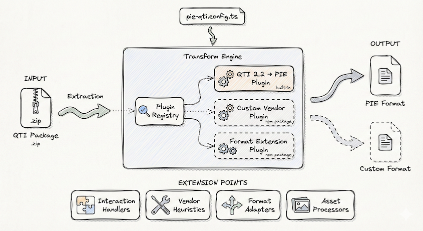
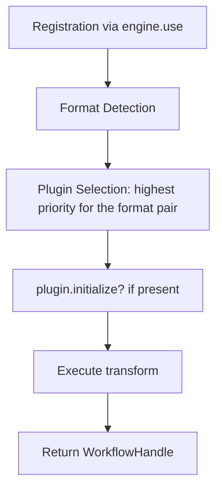

# QTI Transformation Engine

Comprehensive guide to the PIE-QTI transformation framework architecture, plugin system, and extensibility model.

## Table of Contents

1. [Overview](#overview)
2. [Architecture](#architecture)
3. [Plugin System](#plugin-system)
4. [Transform Engine](#transform-engine)
5. [Extensibility Points](#extensibility-points)
6. [Building Custom Plugins](#building-custom-plugins)
7. [Host Integration](#host-integration)
8. [CLI Integration](#cli-integration)
9. [Best Practices](#best-practices)

---

## Overview

The PIE-QTI transformation framework provides a flexible, plugin-based architecture for bidirectional content transformation between assessment formats: QTI → PIE ingest and PIE → QTI 2.2 or QTI 3.0 export (3.0 via `targetVersion: '3.0'`).

### Key Features

- **Plugin-Based Architecture** — Extensible through custom plugins
- **Priority-Based Selection** — Vendor plugins override default transformers
- **Format Agnostic** — Support for multiple source and target formats
- **Asset Resolution contract** — an `AssetResolver` hook hosts can drive for vendor-specific asset URLs and CDN integration (asset URLs themselves pass through the transform as authored)
- **Vendor Extensions** — Custom transformers for proprietary QTI extensions
- **Source Profiles** — Scored, traceable detection of real-world QTI sources with composable item handlers, decorators, fallback policy, package sidecars, and structured conversion trace (see [SOURCE-PROFILES.md](SOURCE-PROFILES.md))
- **Storage Abstraction** — The `StorageBackend` contract (`@pie-qti/transform-types`) is host-implemented: optional for single transforms, required for batch. No concrete backends ship in this repository.

### Architecture Diagram



The diagram illustrates:

- **Transform Engine** — Core orchestration layer
- **Plugin Registry** — Priority-based plugin management
- **Transform Plugins** — Format-specific transformers (QTI→PIE, PIE→QTI)
- **Vendor Extensions** — Custom plugins for vendor-specific content
- **Storage Backends** — The `StorageBackend` contract, implemented by the embedding application

For the dedicated QTI → PIE extension surface introduced for real-world third-party imports (source profiles, item handlers, decorators, fallback policy, package sidecars, conversion trace), see the diagram in [SOURCE-PROFILES.md](SOURCE-PROFILES.md).

---

## Architecture

### Core Components

```
┌─────────────────────────────────────────────────────────────┐
│                     Transform Engine                         │
│  Orchestrates transformations, manages plugins, handles     │
│  format detection, and routes content to appropriate plugins │
├─────────────────────────────────────────────────────────────┤
│  ┌──────────────────────────────────────────────────────┐  │
│  │             Plugin Registry                          │  │
│  │  - Registers transform plugins                       │  │
│  │  - Manages plugin priorities                         │  │
│  │  - Selects appropriate plugin for format pair        │  │
│  └──────────────────────────────────────────────────────┘  │
│                          │                                   │
│                          ▼                                   │
│  ┌──────────────────────────────────────────────────────┐  │
│  │          Transform Plugins                           │  │
│  │                                                       │  │
│  │  QTI → PIE Plugin (priority: 100)                    │  │
│  │  PIE → QTI 2.2 Plugin (priority: 100)                │  │
│  │  Vendor Plugin A (priority: 500)                     │  │
│  │  Vendor Plugin B (priority: 600)                     │  │
│  └──────────────────────────────────────────────────────┘  │
│                          │                                   │
│                          ▼                                   │
│  ┌──────────────────────────────────────────────────────┐  │
│  │          Extensibility Layer                         │  │
│  │                                                       │  │
│  │  - Custom transformers                               │  │
│  │  - Asset resolvers                                   │  │
│  │  - Vendor-specific handlers                          │  │
│  │  - Source profiles, item handlers, decorators        │  │
│  │  - Built-in transform registry (QtiToPieRegistry)    │  │
│  │  - Response processing extensions                    │  │
│  └──────────────────────────────────────────────────────┘  │
│                          │                                   │
│                          ▼                                   │
│  ┌──────────────────────────────────────────────────────┐  │
│  │          Storage Abstraction                         │  │
│  │                                                       │  │
│  │  StorageBackend contract (@pie-qti/transform-types)  │  │
│  │  - Host-implemented backends                         │  │
│  │  - Optional for single transforms                    │  │
│  │  - Required for batch transforms                     │  │
│  └──────────────────────────────────────────────────────┘  │
└─────────────────────────────────────────────────────────────┘
```

### Component Responsibilities

#### Transform Engine

**Package:** `@pie-qti/transform-core`

**Responsibilities:**
- Accept transform requests with source content and target format
- Detect or validate source format
- Find appropriate plugin via registry
- Execute transformation
- Return standardized results

**Key Methods:**
```typescript
class TransformEngine {
  use(plugin: TransformPlugin): this;
  transform(input: string | object, options: TransformOptions): Promise<WorkflowHandle<TransformItemOutput>>;
}
```

> **Note on result shapes:** the engine-level result (`await handle.result()`) exposes the single-item output `{ pieConfig, warnings, errors, metadata }`. The plugin-level `TransformOutput` interface (implemented by plugins and described below) exposes `{ items, format, metadata, ... }`.

#### Plugin Registry

**Package:** `@pie-qti/transform-core`

**Responsibilities:**
- Register plugins with metadata (id, version, formats, priority)
- Maintain priority-ordered plugin lists
- Select best plugin for format pair
- Handle plugin conflicts and overrides

**Selection Algorithm** (`PluginRegistry.findPlugin`):
```typescript
// Filter by the exact format pair, sort by priority (descending), first wins.
// canHandle() is NOT consulted — selection is priority-based on the pair alone.
const candidates = plugins
  .filter(p => p.sourceFormat === source && p.targetFormat === target)
  .sort((a, b) => (b.priority ?? 100) - (a.priority ?? 100));

return candidates[0];
```

`canHandle()` exists on the plugin contract for your own consumers and tests
(`PluginRegistry.findCompatiblePlugins` calls it) — the engine's transform
path never does. Registration throws on duplicate plugin `id`s.

#### Transform Plugins

**Packages:**
- `@pie-qti/to-pie` — QTI → PIE
- `@pie-qti/pie-to-qti2` — PIE → QTI 2.2 (default) or QTI 3.0 via `targetVersion: '3.0'`
- Vendor-specific plugins (custom)

**Interface:**
```typescript
interface TransformPlugin {
  readonly id: string;
  readonly version: string;
  readonly name: string;
  readonly sourceFormat: TransformFormat;
  readonly targetFormat: TransformFormat;
  readonly priority?: number;

  canHandle(input: TransformInput): Promise<boolean>;
  transform(input: TransformInput, context: TransformContext): Promise<TransformOutput>;
}
```

**Responsibilities:**
- Declare the formats it transforms (`sourceFormat` → `targetFormat`) and its priority
- Perform the format transformation
- Report errors and warnings through the `TransformOutput` contract
- Optionally offer `canHandle()` for consumers/tests and `initialize`/`validate`/`dispose` lifecycle hooks

---

## Plugin System

### Plugin Lifecycle



### Plugin Priority

When multiple plugins are registered for the same `(sourceFormat, targetFormat)` pair, the
**highest-priority** plugin is selected — unconditionally, for every input on that pair:

| Priority Range | Purpose | Example Use Case |
|----------------|---------|------------------|
| 1-99 | Low priority | Fallback implementations |
| 100-499 | Normal priority | Default framework plugins |
| 500-999 | High priority | Vendor-specific overrides |
| 1000+ | Critical priority | Framework internals |

A wrapper plugin registered at priority 500 for `qti22` → `pie` therefore takes
over **all** `qti22` → `pie` traffic — there is no per-input fallback to the
lower-priority plugin. Build any "is this my vendor's content?" decision inside
`transform()` (delegate to `QtiToPiePlugin` for content you don't handle), or
better, use the [vendor hooks](VENDOR-TRANSFORM-PLUGIN-GUIDE.md) instead of a
wrapper plugin for vendor content on a supported pair.

### Plugin Registration

#### CLI Registration

The shipped CLI (`tools/cli/src/commands/transform.ts`) creates a `TransformEngine`, registers `QtiToPiePlugin`, and supports the `qti22:pie` format pair out of the box. Vendor plugins register the same way. The snippet below is illustrative:

```typescript
import { TransformEngine } from '@pie-qti/transform-core';
import { QtiToPiePlugin } from '@pie-qti/to-pie';
import { vendorAcmePlugin } from '@vendor/acme-plugin';

const engine = new TransformEngine();

// Register default plugin
engine.use(new QtiToPiePlugin());

// Register vendor plugins (higher priority)
engine.use(vendorAcmePlugin);
```

The CLI ships four real commands: `transform`, `batch-transform`, `analyze-qti`, and `discover-qti`.

#### Host Application Registration

Applications and CLIs register the core plugin and any vendor extensions directly with the engine:

```typescript
import { TransformEngine } from '@pie-qti/transform-core';
import { QtiToPiePlugin } from '@pie-qti/to-pie';
import {
  AcmeVendorDetector,
  AcmeSliderTransformer,
} from '@pie-qti/demo-vendor-extensions';

export function createEngine(): TransformEngine {
  const engine = new TransformEngine();
  engine.use(new QtiToPiePlugin({
    vendorDetectors: [new AcmeVendorDetector()],
    vendorTransformers: [new AcmeSliderTransformer()],
  }));

  return engine;
}
```

---

## Transform Engine

### Transform Process Flow

```
1. Input Validation
   ↓
2. Format Detection (if not specified)
   ↓
3. Plugin Selection (via registry)
   ↓
4. Plugin Execution
   ↓
5. Result Aggregation
   ↓
6. Output Formatting
```

### Input Structure

```typescript
interface TransformInput {
  content: string | object;           // QTI XML string or PIE object
  format?: TransformFormat;           // Optional format hint (auto-detected if absent)
  metadata?: Record<string, any>;     // Additional metadata (hosts may hint the vendor here)
  sidecar?: unknown;                  // PIE source sidecar for lossless round-trip
}

interface TransformContext {
  logger?: ServerLogger;
  vendor?: string;                    // Vendor hint from TransformOptions
  options?: Record<string, any>;      // The TransformOptions the engine was called with
  storage?: StorageBackend;
  sessionId?: string;
  userId?: string;
  metadata?: Record<string, unknown>;
}
```

### Output Structure

Two shapes matter, at two levels:

**Plugin-level** — what `plugin.transform()` returns and what
`expectSuccessfulTransform` asserts:

```typescript
interface TransformOutput {
  items: TransformOutputItem[];      // Transformed items
  format: TransformFormat;            // Output format
  metadata: TransformMetadata;        // sourceFormat, targetFormat, pluginId,
                                      // timestamp, itemCount, processingTime,
                                      // + optional qtiVersion, conversionTrace,
                                      // sourceProfiles, sourceDiagnostics
  warnings?: TransformWarning[];
  errors?: TransformError[];
}

interface TransformOutputItem {
  content: any;                       // Transformed content
  format: TransformFormat;            // Item format
  sidecar?: PieSourceSidecar;         // `<item>.pie.json` round-trip data
}
```

The PIE → QTI plugin additionally attaches `passageFiles` and, when package
generation is requested, a `manifest` onto its results — those are
`@pie-qti/pie-to-qti2` additions, not part of the shared `TransformOutput`
contract.

**Engine-level** — what `engine.transform(...)` resolves to via the
`WorkflowHandle`:

```typescript
const handle = await engine.transform(input, { targetFormat: 'pie' });
const result = await handle.result();
// result: TransformItemOutput = { pieConfig, warnings, errors, metadata }
//   pieConfig — the transformed content
//   errors    — string[] (messages)
//   metadata  — TransformMetadata plus itemId and vendorDetected?
```

### Error Handling

Errors are categorized for appropriate handling:

```typescript
enum ErrorCategory {
  VALIDATION = 'validation',          // Invalid input (malformed QTI)
  CONFIGURATION = 'configuration',    // Setup errors (missing config)
  INTERNAL = 'internal',              // Plugin bugs
  EXTERNAL = 'external',              // Service failures (S3 down)
}

interface TransformError {
  itemId?: string;
  message: string;
  code?: string;
  category: ErrorCategory;
  recoverable: boolean;               // Can retry?
  cause?: Error;
  context?: Record<string, unknown>;
}
```

At the engine level, `result.errors` is a plain `string[]`; the categorized
`TransformError` objects live on the plugin-level `TransformOutput`:

```typescript
try {
  const handle = await engine.transform(input, { targetFormat: 'pie' });
  const result = await handle.result();

  if (result.errors.length > 0) {
    throw new Error(`Transform failed: ${result.errors.join(', ')}`);
  }

  return result.pieConfig;
} catch (error) {
  // Handle transform failure
}
```

---

## Extensibility Points

The transformation framework provides multiple extensibility points for custom behavior.

### 1. Custom Transform Plugins

Create plugins for **new format pairs** — an independent source format, or a new export target.

**Use Cases:**
- Support new assessment formats (e.g., Moodle XML → PIE)
- Implement specialized transformations

> For vendor-specific handling of QTI content, use the vendor hooks instead
> (below and in the [Vendor Plugin Guide](VENDOR-TRANSFORM-PLUGIN-GUIDE.md)) — a
> wrapper plugin registered on a supported pair takes over that pair entirely.

**Example:**

```typescript
export class MoodleXmlPlugin implements TransformPlugin {
  readonly id = 'moodle-xml-to-pie';
  readonly sourceFormat = 'moodle-xml' as TransformFormat;
  readonly targetFormat = 'pie' as TransformFormat;
  readonly priority = 100;

  // canHandle is for your own consumers/tests — the engine selects this plugin
  // for the pair above regardless of it.
  async canHandle(input: TransformInput): Promise<boolean> {
    return typeof input.content === 'string' &&
           input.content.includes('<quiz>');
  }

  async transform(input: TransformInput, context: TransformContext): Promise<TransformOutput> {
    // Transform logic
  }
}
```

### 2. Vendor Transformers (within the QTI → PIE plugin)

For vendor-specific content on the QTI → PIE pair, `QtiToPiePlugin` accepts a
`VendorTransformer` hook — a whole-item replacement that runs only when a
`VendorDetector` matched the vendor, with automatic fallback to the standard
pipeline if it throws:

```typescript
import type { VendorTransformer } from '@pie-qti/transform-types';

export class AcmeSliderTransformer implements VendorTransformer {
  vendor = 'acme';

  canHandle(qtiXml: string, vendorInfo: VendorInfo, parsedDoc: HTMLElement): boolean {
    return parsedDoc.querySelectorAll('sliderInteraction').length > 0;
  }

  async transform(qtiXml: string, vendorInfo: VendorInfo, context: TransformContext,
                  parsedDoc: HTMLElement): Promise<TransformOutput> {
    // Map the vendor interaction to a PIE model
  }
}
```

Registration, the other four hooks (detector, CSS-class extractor, metadata
extractor, asset resolver), and the per-item firing order are in the
[Vendor Plugin Guide](VENDOR-TRANSFORM-PLUGIN-GUIDE.md);
`packages/demo-vendor-extensions/` is the reference implementation.

### 3. Asset Resolvers

The `AssetResolver` contract resolves vendor-specific asset URLs to
accessible locations:

```typescript
import type { AssetResolver, ResolvedAsset } from '@pie-qti/transform-types';

export class AcmeCDNResolver implements AssetResolver {
  name = 'acme-cdn';

  canResolve(assetType: string, assetUrl: string): boolean {
    return assetUrl.startsWith('acme://') || assetUrl.startsWith('acme-cdn://');
  }

  async resolve(assetType: string, assetUrl: string, baseDir: string): Promise<ResolvedAsset> {
    const path = assetUrl.replace(/^acme(-cdn)?:\/\//, '');
    return { url: `https://cdn.acme.com/assets/${path}` };
  }
}
```

**The pipeline does not call resolvers on its own** — asset URLs pass through
the transform as authored (a stylesheet `href` lands in
`config.resources.stylesheets[]` exactly as received). Drive resolution
yourself with `resolveAssetWithHooks` from `@pie-qti/to-pie`, or rewrite URLs
to durable references before transforming. See the
[Vendor Plugin Guide](VENDOR-TRANSFORM-PLUGIN-GUIDE.md) for both patterns.

### 4. Source Profiles (preferred for QTI → PIE imports)

Source profiles target the specific extension surface that real-world QTI imports need: scored detection at package and item level, composable item handlers that can delegate to built-in transforms, decorators that patch the generic PIE model, structured fallback policy and diagnostics, package sidecars, and a `ConversionTrace` of every decision.

**Use Cases:**

- Recognise a known source/vintage of QTI and apply tailored handling. Generic source-neutral profiles can live in `@pie-qti/source-profiles`; partner/publisher profiles should live in host packages and register through the same API.
- Replace built-in interaction transforms for proprietary item types — or delegate back to a built-in handler via `delegate.continue()` and only adjust outputs through decorators.
- Fail closed (`fallbackPolicy: 'block-generic'`) for proprietary content that would otherwise produce a lossy generic conversion.
- Emit package-level sidecars (source XML, catalogs, rubrics, stylesheets, assets) with stable IDs and inferred MIME types.
- Expose source-profile matches, source diagnostics, and conversion trace through `result.metadata` so host applications can show "which extension fired and why".

**Example:**

```typescript
import { transformQtiPackageToPie } from '@pie-qti/to-pie';
import { defaultSourceProfiles } from '@pie-qti/source-profiles';

const result = await transformQtiPackageToPie({
  packageId,
  manifestXml,
  fileAccess,
  sourceProfiles: [...defaultSourceProfiles, myCustomProfile],
});

result.sourceProfiles;                 // matched profiles (package-level)
result.sourceDiagnostics;              // structured diagnostics (info/warn/error)
result.standardCandidates;             // raw standards evidence from package and item extraction
result.sidecars;                       // source XML, catalogs, rubrics, assets, ...
result.conversionTrace.events;         // ordered trace events
```

See [SOURCE-PROFILES.md](SOURCE-PROFILES.md) for the full authoring reference (detection, item handlers, decorators, fallback policy, sidecars, conversion trace) and the architecture diagram. The five vendor hooks above remain available for whole-pipeline replacement, asset URL rewriting, CSS-class interception, and vendor-keyed metadata extraction.

---

### 5. Storage Backends

Batch transforms require a storage backend; single transforms work without one.
No concrete backends ship in this repository — hosts implement the
`StorageBackend` contract from `@pie-qti/transform-types`
(`packages/types/src/storage/index.ts`: `readText`/`writeText`,
`readBuffer`/`writeBuffer`, `write`, streaming operations, `exists`, `list`,
`delete`, plus optional batch and directory helpers) and pass it to
`new TransformEngine(orchestrator, storage)`.

**Use Cases:**
- Enterprise storage systems
- Cloud storage providers
- Database storage

**Example (host-implemented):**

```typescript
import type { StorageBackend } from '@pie-qti/transform-types';

export class DatabaseStorageBackend implements StorageBackend {
  readonly name = 'database';

  async initialize(): Promise<void> { /* connect */ }

  async readText(uri: string): Promise<string> {
    const record = await db.files.findOne({ uri });
    return record.content.toString('utf-8');
  }

  async writeText(uri: string, content: string): Promise<void> {
    await db.files.updateOne({ uri }, { content }, { upsert: true });
  }
  // ... implement the remaining required members
}
```

---

## Building Custom Plugins

See the comprehensive [Vendor Plugin Guide](VENDOR-TRANSFORM-PLUGIN-GUIDE.md) for detailed instructions.

### Quick Start

1. **Create Plugin Package**

```bash
mkdir -p packages/vendor-custom-plugin
cd packages/vendor-custom-plugin
npm init -y
```

2. **Implement Plugin Interface**

```typescript
import type { TransformPlugin } from '@pie-qti/transform-types';

export class VendorCustomPlugin implements TransformPlugin {
  readonly id = 'vendor-custom-qti22-to-pie';
  readonly sourceFormat = 'qti22' as const;
  readonly targetFormat = 'pie' as const;
  readonly priority = 500;

  async canHandle(input: TransformInput): Promise<boolean> {
    // Vendor detection logic
  }

  async transform(input: TransformInput, context: TransformContext): Promise<TransformOutput> {
    // Transformation logic
  }
}
```

3. **Register Plugin**

```typescript
import { TransformEngine } from '@pie-qti/transform-core';
import { VendorCustomPlugin } from './vendor-custom-plugin';

const engine = new TransformEngine();
engine.use(new VendorCustomPlugin());
```

> `createEngine()` is not exported from `@pie-qti/transform-core` — construct the engine directly with `new TransformEngine()` and register plugins with `engine.use(...)`. `@pie-qti/test-utils` does not provide a preconfigured engine either; it provides mock plugins (`MockTransformPlugin`, `createMockPlugin`) and result assertions (`expectSuccessfulTransform`) for plugin-level tests. Tests that want one-call engine setup define a small local helper around `new TransformEngine()`, as `packages/to-pie/tests/test-utils.ts` does.

### Testing Plugins

```typescript
import { describe, test, expect } from 'bun:test';
import { TransformEngine } from '@pie-qti/transform-core';
import { VendorCustomPlugin } from '../src';

describe('VendorCustomPlugin', () => {
  test('should handle vendor-specific content', async () => {
    const engine = new TransformEngine();
    engine.use(new VendorCustomPlugin());

    const handle = await engine.transform(qtiXml, {
      targetFormat: 'pie',
    });
    const result = await handle.result();

    expect(result.errors).toHaveLength(0);
    expect(result.pieConfig).toBeDefined();
    expect(result.metadata.sourceFormat).toBe('qti22');
    expect(result.metadata.targetFormat).toBe('pie');
  });
});
```

---

## Host Integration

Product import workflows belong in host applications, which own production import orchestration, persistence, permissions, and editorial state. This repository ships the reusable transform packages; hosts compose them.

### Suggested module breakdown

```
Host import surface
├── Upload Interface
│   ├── File upload (ZIP, XML, JSON)
│   ├── Package extraction
│   └── Content validation
├── Analysis Module
│   ├── Package structure inspection
│   ├── Item discovery
│   └── Issue detection
├── Transform Module
│   ├── Engine initialization
│   ├── Plugin registration
│   ├── Batch transformation
│   └── Progress reporting
├── Preview Module
│   ├── QTI Player integration
│   ├── PIE Player integration
│   └── Side-by-side comparison
└── Export Module
    ├── Download results
    ├── Package generation
    └── Manifest creation
```

### Plugin Integration

Plugin and vendor-extension support is a package-level contract. Production hosts should register the extension types in their own application bootstrap code.

### Storage Integration

Storage is a host concern: the `storage` key in the transform config only
records the backend name the host should act on (see [CONFIGURATION.md](CONFIGURATION.md)).
The host implements `StorageBackend` from `@pie-qti/transform-types` and wires it
into the engine:

```typescript
import { TransformEngine } from '@pie-qti/transform-core';
import { MyHostStorageBackend } from './my-storage-backend';

const storage = new MyHostStorageBackend(hostConfig.storage.options);
const engine = new TransformEngine(undefined, storage);
```

A reference in-memory mock exists for tests in `@pie-qti/test-utils`
(`packages/test-utils/src/mocks/storage.ts`).

---

## CLI Integration

The command-line interface ([tools/cli](../tools/cli/)) provides batch transformation capabilities.

### CLI Architecture

```bash
bun run pie-qti -- transform input.xml --format qti22:pie --output output.json
```

The CLI:
1. Parses command-line arguments
2. Initializes transform engine with plugins
3. Loads input content
4. Executes transformation
5. Writes output files
6. Reports results

### Plugin Loading

The shipped `transform` command registers `QtiToPiePlugin`; the snippet below is illustrative:

```typescript
// tools/cli/src/commands/transform.ts
export async function transformCommand(args: TransformArgs) {
  const engine = new TransformEngine();

  // Load core plugin
  engine.use(new QtiToPiePlugin());

  // Load vendor plugins if configured
  const vendorPlugins = await loadVendorPlugins();
  vendorPlugins.forEach(p => engine.use(p));

  // Execute transformation
  const handle = await engine.transform(await readFile(args.input), {
    targetFormat: 'pie',
  });
  const result = await handle.result();

  // Write results
  await writeResults(result, args.output);
}
```

### Configuration File

Config files register plugins per format pair and configure storage, custom detectors, and vendor extensions. See [CONFIGURATION.md](./CONFIGURATION.md) for the config file schema and environment variables. A minimal example:

```json
{
  "plugins": {
    "qti22": {
      "pie": { "module": "@pie-qti/to-pie" }
    }
  }
}
```

---

## Best Practices

### Plugin Development

1. **Use Appropriate Priority**
   - Default plugins: 100-499
   - Vendor overrides: 500-699
   - Special cases: 700-999

2. **Detect Vendors with Graded Confidence**
   For vendor detection (the `VendorDetector` hook), check multiple signals
   and scale `confidence` with how many matched — detections below 0.6 are
   ignored by the pipeline, so be specific to avoid false positives.

3. **Handle Errors Gracefully**
   ```typescript
   try {
     return await this.transform(input, context);
   } catch (error) {
     return {
       items: [],
       format: this.targetFormat,
       metadata: { /* required TransformMetadata fields */ },
       errors: [{
         message: error instanceof Error ? error.message : 'Unknown error',
         category: ErrorCategory.INTERNAL,
         recoverable: false,
       }],
     };
   }
   ```

4. **Fill In the Full Metadata**
   `TransformMetadata` requires `sourceFormat`, `targetFormat`, `pluginId`,
   `timestamp`, `itemCount`, and `processingTime` — hosts and the batch
   pipeline rely on all of them:
   ```typescript
   result.metadata = {
     sourceFormat: this.sourceFormat,
     targetFormat: this.targetFormat,
     pluginId: this.id,
     timestamp: new Date(),
     itemCount: result.items.length,
     processingTime: Date.now() - startTime,
   };
   ```

5. **Test Round-Trips**
   ```typescript
   test('round-trip preservation', async () => {
     const original = createTestItem();
     const qti = await pieToQti.transform(original);
     const reconstructed = await qtiToPie.transform(qti);
     expect(reconstructed).toEqual(original);
   });
   ```

### Asset Resolution

1. **Use Resolver Chains via the Real Contract**
   ```typescript
   import { resolveAssetWithHooks } from '@pie-qti/to-pie';

   // AssetResolvers: canResolve(assetType, assetUrl) → resolve(assetType, assetUrl, baseDir)
   const resolved = await resolveAssetWithHooks(resolvers, 'image', url, baseDir);
   ```
   The transform pipeline does not invoke resolvers itself — call the helper
   from host code (before or after transforming), or rewrite URLs to durable
   references before the transform.

2. **Cache Resolved URLs**
   ```typescript
   private cache = new Map<string, ResolvedAsset>();

   async resolveAsset(resolvers: AssetResolver[], type: string, url: string): Promise<ResolvedAsset> {
     const cached = this.cache.get(url);
     if (cached) return cached;
     const resolved = await resolveAssetWithHooks(resolvers, type, url, this.baseDir);
     this.cache.set(url, resolved);
     return resolved;
   }
   ```

### Performance

1. **Batch Operations**
   ```typescript
   // Requires a storage backend: new TransformEngine(orchestrator, storage)
   const handle = await engine.transformBatch(inputs, {
     sourceFormat: 'qti22',
     targetFormat: 'pie',
     parallel: 5, // Process 5 items concurrently
   });

   const result = await handle.result();
   console.log(`${result.successful.length} succeeded, ${result.failed.length} failed`);
   ```

2. **Lazy Initialization**
   ```typescript
   private _parser?: Parser;

   get parser(): Parser {
     if (!this._parser) {
       this._parser = new Parser(this.config);
     }
     return this._parser;
   }
   ```

3. **Large Packages**
   The engine has no streaming transform API; the `StorageBackend` contract
   carries the streaming members (`createReadStream`/`createWriteStream`) for
   host-side storage of large content. For big imports, transform per item via
   `transformBatch` and persist through the backend rather than holding a whole
   package in memory.

---

## Related Documentation

- **[PIE-QTI Transformation Guide](PIE-QTI-TRANSFORMATION-GUIDE.md)** — User guide for transformations
- **[Vendor Plugin Guide](VENDOR-TRANSFORM-PLUGIN-GUIDE.md)** — Building custom plugins
- **[Configuration Guide](CONFIGURATION.md)** — Storage and plugin configuration
- **[Architecture Guide](ARCHITECTURE.md)** — Overall system architecture

---

## Support

For questions or issues:

1. Review this documentation and related guides
2. Check examples in `packages/`
3. Open an issue on GitHub with:
   - Plugin code or configuration
   - Input content (QTI or PIE)
   - Error messages and stack traces
   - Expected vs. actual output

## License

MIT
